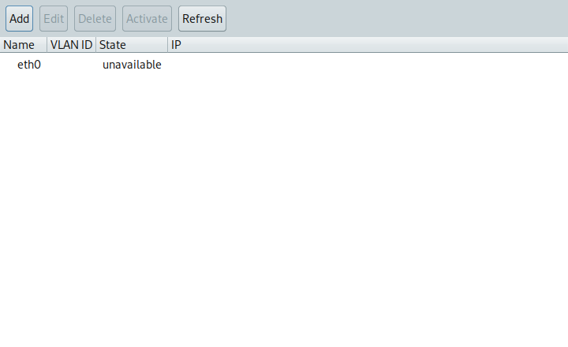
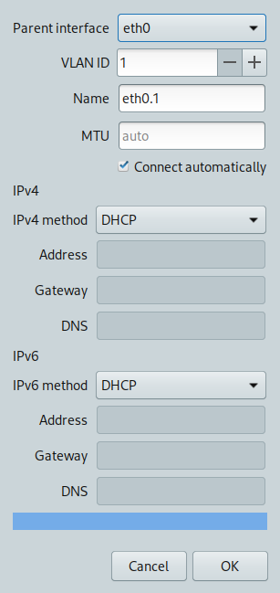

# VlanManager


**VlanManager** is a focused GTK application for creating and managing 802.1Q VLAN connections on wired Linux interfaces. It uses NetworkManager for connection settings and authorization, so the application itself runs as a regular desktop user. The interface is available in English and Italian.

A typical setup is a laptop connected to a tagged switch port: the ordinary Ethernet connection carries untagged traffic, while VlanManager adds interfaces such as `eth0.20` for selected VLAN IDs.

## What you can do

- See wired interfaces and their VLAN connections, including whether a VLAN is active and its IPv4 setting.
- Create, edit, activate, deactivate, and delete VLAN connections.
- Configure IPv4 and IPv6 independently with automatic addressing, a static address, or disabled addressing. Static settings accept an address/prefix, an optional gateway, and DNS servers.
- Choose whether a connection starts automatically and set an optional MTU.
- Check whether the VLAN gateway answers through the VLAN interface after a confirmed change.
- Revert an unconfirmed change after a 20-second countdown. NetworkManager checkpoints protect active devices when available; an in-process undo is used when a checkpoint cannot be created.

### Main window



The tree groups VLAN connections beneath their parent Ethernet interface. Select an interface and choose **Add** to create a VLAN. Select an existing VLAN to edit, delete, activate, or deactivate it. **Refresh** reads the current NetworkManager state again. An interface marked *unmanaged* cannot be changed by the application.

### Create a VLAN



1. Connect a wired interface to a switch port that permits the VLAN's 802.1Q tag, then select that interface in VlanManager.
2. Choose **Add**, enter a VLAN ID from **1 to 4094**, and review the suggested interface name (`<parent>.<id>`). Linux interface names can be at most 15 characters.
3. Select the IPv4 and IPv6 methods. For a static method, enter the address with its prefix (for example `192.0.2.10/24` or `2001:db8::10/64`), then enter an optional gateway and DNS servers of the same IP version.
4. Set automatic connection and MTU as needed, then choose **OK**. NetworkManager may ask for administrator authorization through polkit.
5. If the configuration is correct, choose **Keep** before the countdown ends. Choose **Revert**, close the confirmation dialog, or let the timer expire to restore the previous state.

The pictured interface has no cable link. A VLAN profile can be saved in that situation, but it cannot pass traffic until its parent link and switch configuration are ready.

## Install

VlanManager requires Debian 12 or newer, or a compatible SysLinuxOS release, with NetworkManager, GTK 3, Python 3.11 or newer, and the Linux `8021q` module. The package declares `python3`, `python3-gi`, `gir1.2-gtk-3.0`, `network-manager`, and `iputils-ping` as dependencies.

### From the SysLinuxOS APT repository

On an amd64 system, configure the [SysLinuxOS-Tools repository](https://github.com/fconidi/SysLinuxOS-Tools) if it is not already enabled:

```bash
curl -fsSL https://fconidi.github.io/SysLinuxOS-Tools/client/install-repo.sh | sudo bash
```

Then install and launch VlanManager:

```bash
sudo apt install vlanmanager
vlanmanager
```

APT will also provide future package updates through the same repository.

### From a GitHub release

Download `vlanmanager_0.1.1_all.deb` from the [v0.1.1 release](https://github.com/fconidi/VlanManager/releases/tag/v0.1.1), then install it from the download directory:

```bash
sudo apt install ./vlanmanager_0.1.1_all.deb
vlanmanager
```

Using `apt install ./...deb` lets APT resolve the declared dependencies. The package adds VlanManager to the **Network** and **SysLinuxOS Tools** desktop menus.

### Run from source

Install the dependencies listed above, clone the repository, and run:

```bash
git clone https://github.com/fconidi/VlanManager.git
cd VlanManager
python3 -m vlanmanager
```

No root shell is needed to launch the GUI. NetworkManager handles authorization when a connection is changed.

## How confirmation and reachability work

VlanManager asks for confirmation after creating, editing, deleting, or deactivating a VLAN. For active devices, it requests a NetworkManager checkpoint before applying the change. If confirmation does not arrive, NetworkManager restores its saved state. A checkpoint protects **all** devices during its short lifetime, so avoid making unrelated network changes while the confirmation dialog is open. When a checkpoint is unavailable, VlanManager attempts to undo the operation within its own process; that fallback cannot recover from the application being forcibly terminated.

A failed activation does not always mean the profile is invalid. With a disconnected cable, an untagged switch port, or no DHCP service on the VLAN, the profile can still be created, but it will remain inactive or lack a gateway. After confirmation, the reachability check reads the gateway from the active device configuration and sends one ping through the VLAN interface. If no gateway was obtained, the application reports that the check could not be completed. A gateway that does not answer is reported separately.

## Scope and troubleshooting

| Symptom | Check |
|---|---|
| Wired interface is *unavailable* | Check the cable, adapter, and switch link. A VLAN needs a working parent link to pass traffic. |
| Wired interface is *unmanaged* | Configure the interface under NetworkManager; VlanManager does not take control of it. |
| No address or gateway after activation | Check that the switch port permits the VLAN tag and that DHCP is available, or use valid static settings. |
| Gateway does not answer | Check the VLAN ID, switch port, gateway, and addressing. The check uses the VLAN interface, so another interface's route does not count. |
| Authorization is denied | Use an account permitted by the system's NetworkManager polkit policy. |
| The 8021q module is unavailable | Install a kernel with VLAN support or make the module available. |

Only wired parent interfaces are supported. A Wi-Fi client does not place 802.1Q tags on its own traffic; the access point controls that mapping. Untagged traffic remains on the parent Ethernet connection. Bridge creation and profile import/export are outside the current feature set.

## License

VlanManager is licensed under [GPL-3.0](LICENSE).
